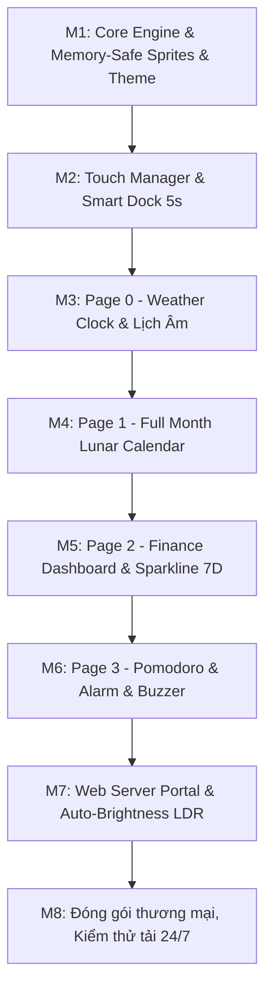

# 📋 KẾ HOẠCH DỰ ÁN: CYD SMARTDESK V2 (BẢN THƯƠNG MẠI)

> **Thiết bị:** ESP32 Cheap Yellow Display (ESP32-2432S028)  
> **Màn hình:** 2.8 inch TFT LCD (320×240), Driver ILI9341_2, Cảm ứng điện trở XPT2046  
> **Mục tiêu:** Đồng hồ để bàn thông minh phân khúc thương mại cao cấp — Mượt mà, 16-bit màu, ổn định tuyệt đối, giao diện hiện đại.

---

## 1. ĐÁNH GIÁ PHẦN CỨNG & RÀNG BUỘC KỸ THUẬT

### 1.1. Bộ nhớ RAM & Hiển thị 16-bit màu
* **Đặc tính:** ESP32-WROOM-32 tiêu chuẩn **không có PSRAM**. Khối RAM liên tục tối đa khi bật WiFi chỉ khoảng $110 - 130\text{ KB}$.
* **Ràng buộc:** Một Sprite 16-bit toàn màn hình ($320\times 240\times 2 = 153.6\text{ KB}$) sẽ gây nguy cơ cạn RAM nếu vừa chạy Sprite vừa xử lý Web Server và JSON.
* **Giải pháp kiến trúc V2:**
  * Áp dụng kiến trúc **Component / Card Sprites cục bộ** (hoặc Band Buffering):
    * Card Đồng hồ: $160\times 70\text{ px}$ ($\approx 22\text{ KB}$)
    * Card Thời tiết / Tài chính: $140\times 70\text{ px}$ ($\approx 19\text{ KB}$)
    * Thanh Dock: $280\times 40\text{ px}$ ($\approx 22\text{ KB}$)
  * **Lợi ích:** Đạt **100% màu 16-bit (RGB565)** rực rỡ, loại bỏ hoàn toàn hiện tượng nhấp nháy, đồng thời RAM trống luôn dư dả $>120\text{ KB}$ để chạy mượt mà Web Server, JSON parse và WiFi.

### 1.2. Trải nghiệm Cảm ứng Điện trở (Resistive Touch UI/UX)
* **Đặc tính:** Cảm ứng điện trở yêu cầu lực ấn cơ học, độ chính xác tọa độ có dung sai và **không nhạy với thao tác vuốt (swipe)**.
* **Quy chuẩn UI/UX:**
  1. **Tuyệt đối không dùng thao tác vuốt (No Swipe gestures).**
  2. **Vùng chạm lớn (Hitbox $\ge 40\times 40\text{ px}$):** Nút bấm to, bo góc, khoảng cách giữa các nút rộng rãi.
  3. **Phản hồi âm thanh & thị giác tức thì:**
     * Khi nhấn trúng nút: Còi buzzer (GPIO 26) click siêu nhẹ ($15\text{ms}$ ở $2400\text{Hz}$) + Nút đổi màu highlight lập tức.
  4. **Bộ lọc khử nhiễu:** Thuật toán Median Filter + Exponential Moving Average để loại bỏ điểm chạm giả.
  5. **Màn hình hiệu chuẩn (Calibration):** Lưu thông số 4 góc vào NVS Flash để tương thích 100% với từng lô màn hình.

---

## 2. ĐÁNH GIÁ NGUỒN DỮ LIỆU TÀI CHÍNH & GIÁ VÀNG

Dự án tham chiếu `ESP32_CYD_Smart_Desk_Studio_Pro` đang sử dụng 3 API sau:

| API | Nguồn | Mục đích | Đánh giá & Khuyến nghị |
| :--- | :--- | :--- | :--- |
| **Giá vàng SJC & Lịch sử 7 ngày** | `https://www.vang.today/api/prices?type=SJL1L10&days=7` | Lấy giá Mua/Bán SJC, độ biến động trong ngày và mảng lịch sử 7 ngày thực tế. | **CỰC KỲ TỐT, TIẾP TỤC DÙNG:** API trả về JSON chuẩn, có dữ liệu 7 ngày thật, phản hồi nhanh (<1s), hoàn toàn miễn phí không cần API key. |
| **Tỉ giá Ngoại tệ** | `https://open.er-api.com/v6/latest/USD` | Lấy tỉ giá USD, EUR, JPY, CAD, GBP, AUD, SGD sang VND. | **RẤT TỐT, TIẾP TỤC DÙNG:** API chuẩn quốc tế của ExchangeRate-API, miễn phí, không cần token, cập nhật mỗi 24h. |
| **Giá vàng thế giới Spot** | `https://api.binance.com/api/v3/ticker/price?symbol=PAXGUSDT` | Giá vàng thế giới quy đổi (PAX Gold / USD). | **TÙY CHỌN DÙNG THÊM:** Binance API công khai cực kỳ ổn định, uptime 99.99%. |

> **Biện pháp an toàn cho sản phẩm thương mại:**
> Luôn có **bộ đệm dữ liệu (Cache)** lưu giá trị gần nhất vào NVS/RAM kèm mảng giá trị mặc định. Nếu mất mạng hoặc API bảo trì, thiết bị vẫn hiển thị giá trị gần nhất mà không bị crash hoặc đứng màn hình.

---

## 3. THIẾT KẾ 4 TRANG TÍNH NĂNG CHÍNH

### Trang 0: Đồng hồ Thời tiết & Báo thức (Weather Clock Dashboard & Alarm)
* **Thời gian:** Giờ:Phút (font số lớn hiện đại, hiệu ứng neon đổ bóng), Giây nhấp nháy tinh tế.
* **Biểu tượng Báo thức (Alarm Indicator):**
  * Icon chuông nhỏ tinh tế `🔔 07:00` đặt cạnh số đồng hồ chính (Sáng vàng khi BẬT, xám mờ khi TẮT).
  * **Tương tác chạm thông minh:** Chạm vào cụm Card Đồng hồ chính (hitbox siêu rộng $300\times 110\text{ px}$) sẽ kích hoạt **POPUP_ALARM** modal:
    * Công tắc gạt Toggle Bật/Tắt nhanh.
    * 4 nút điều chỉnh Giờ và Phút to bản `[ + ]` / `[ - ]` cách ly an toàn khỏi thanh Dock.
    * Nút thử chuông (Test buzzer click) và đồng bộ lưu tức thì vào NVS Flash / Web Dashboard.
* **Lịch Dương & Lịch Âm:** Thứ, Ngày tháng năm đầy đủ, Can Chi ngày (thuật toán thiên văn Hồ Ngọc Đức chuẩn 100%).
* **Card Thời tiết & Lịch âm:** Chạm mở popup chi tiết (Weather Forecast & Lunar Horoscopes).

### Trang 1: Lịch Tháng Âm - Dương Toàn cảnh (Full Month Lunar Calendar)
* Quyển lịch để bàn gáy da Đỏ Đô + gáy lò xo kim loại 6 khoen.
* 3 tờ giấy Obsidian xếp lớp chân thực (Stepped Paper Stack), căn lề toán học đối xứng cho ngày hiện tại và góc bo tròn mịn.

### Trang 2: Bảng Tài chính & Biểu đồ Sóng 7 ngày (Finance & 7-Day Sparkline)
* Card Giá vàng SJC: Mua – Bán (triệu đ/lượng) kèm độ biến động.
* Card Ngoại tệ: Tỉ giá USD, EUR.
* Biểu đồ sóng 7 ngày (7-Day Sparkline Area Chart).

### Trang 3: Trạm Tập trung Pomodoro Chuyên dụng (Dedicated Focus Station)
* **Toàn màn hình ($320\times 240$):** Tận dụng tối đa không gian cho trải nghiệm tập trung làm việc chuyên sâu.
* **Đồng hồ Vòng cung Tròn phát sáng (Glowing Circular Arc Gauge, $R \approx 60\text{px}$):**
  * Cung tròn đổi màu: Đỏ Cam Neon (Focus 25m) và Xanh Ngọc Mint (Break 5m).
  * Vòng tròn tiến độ vẽ mịn (Smooth Arc) giảm dần/tăng dần theo từng giây.
  * Tâm vòng hiển thị đếm ngược mm:ss to rõ (Font 7 hoặc Font số mượt mà).
* **Quản lý Phiên làm việc (Session Tracker):**
  * Dãy chấm biểu thị tiến độ (ví dụ: Session 1/4, 2/4...).
  * Chuyển đổi linh hoạt giữa các chế độ: Focus (25m), Short Break (5m), Long Break (15m).
* **Cụm điều khiển an toàn ($Y \le 180$):**
  * Nút to bản: `START` / `PAUSE` / `RESET` dễ bấm cho cảm ứng điện trở, hoàn toàn không chạm nhầm vào Dock.
  * Phản hồi âm thanh còi buzzer click khi bấm và chuông bip-bip khi hoàn thành phiên.

---

## 4. THANH DOCK ĐIỀU HƯỚNG THÔNG MINH (SMART BOTTOM DOCK)

* **Vị trí:** Nằm ở đáy màn hình ($y = 195 \to 240$).
* **Nút bấm:** 4 nút chuyển trang tương ứng (Clock, Calendar, Finance, Pomodoro) + 1 nút Cài đặt (Theme/WiFi/Brightness). Kích thước mỗi nút $\ge 40\times 36\text{ px}$.
* **Cơ chế Tự ẩn sau 5 giây:**
  * Sau 5 giây không có thao tác chạm, Dock trượt thu gọn xuống đáy.
  * **Trạng thái ẩn:** Chỉ chừa lại một vạch gạch ngang neon mảnh ($40\times 3\text{ px}$) ở mép dưới để biểu thị.
  * **Đánh thức:** Chạm nhẹ vào bất kỳ điểm nào ở khu vực mép dưới màn hình ($y > 210$), thanh Dock lập tức trượt lên trở lại và reset bộ đếm 5s.

---

## 5. HỆ THỐNG ĐỔI THEME BẢO TOÀN BỐ CỤC (LAYOUT-PRESERVING THEME ENGINE)

Để người dùng tự do đổi theme màu mà **không làm xô lệch bất kỳ pixel nào trong bố cục**:
* Tách biệt hoàn toàn giữa **Tọa độ hình học (Layout Geometry)** và **Bảng màu (Color Tokens)**.
* Toàn bộ mã vẽ chỉ gọi các biến token: `theme.bg`, `theme.card`, `theme.accent`, `theme.text_main`, `theme.text_dim`, `theme.glow`.

### 3 Bảng màu Thương mại Tuyển chọn:
1. **Theme 1 — Cyberpunk Neon (Mặc định):**
   * Nền: Xanh Navy vũ trụ (`#0A0E1A`)
   * Accent: Neon Cyan (`#00E5FF`) + Cam thể thao (`#FF7700`)
   * Thẻ: Xanh đêm mờ (`#151C2E`)
2. **Theme 2 — Minimal Obsidian (Sang trọng, tối giản):**
   * Nền: Đen than chì OLED (`#121212`)
   * Accent: Xanh ngọc lục bảo (`#00E676`) + Bạc ánh kim (`#E0E0E0`)
   * Thẻ: Xám than (`#1E1E1E`)
3. **Theme 3 — Sunset Amber (Ấm áp, thư thái):**
   * Nền: Tím thẫm nửa đêm (`#181024`)
   * Accent: Vàng hoàng hôn (`#FFB300`) + Đỏ san hô (`#FF5252`)
   * Thẻ: Tím than mờ (`#241935`)

* Lưu Theme đã chọn vào **NVS Flash**, khởi động lại vẫn giữ đúng theme.

---

## 6. LỘ TRÌNH TRIỂN KHAI THEO GIAI ĐOẠN (ROADMAP)

- [x] **Giai đoạn 0:** Khắc phục lỗi màn hình trắng tinh, thêm `invertDisplay(true)`, hoàn tất Fallback 8-bit Sprite.
- [ ] **Giai đoạn 1:** Xây dựng `Theme.h/.cpp` (3 Themes bảo toàn layout) + `Display` Component Sprites 16-bit an toàn RAM.
- [ ] **Giai đoạn 2:** Xây dựng `TouchManager` (Calibration, bộ lọc nhiễu, Hitbox $\ge 40\text{px}$, âm click còi) + Thanh Dock tự ẩn 5s.
- [ ] **Giai đoạn 3:** Hoàn thiện Page 0 (Đồng hồ neon + Thời tiết thực + Âm lịch Việt Nam).
- [ ] **Giai đoạn 4:** Hoàn thiện Page 1 (Lịch tháng Âm - Dương đầy đủ).
- [ ] **Giai đoạn 5:** Tích hợp API Tài chính (Vàng SJC 7 ngày + Ngoại tệ) và vẽ biểu đồ sóng Sparkline mượt mà.
- [ ] **Giai đoạn 6:** Hoàn thiện Page 3 (Pomodoro vòng cung + Báo thức chuông Buzzer).
- [ ] **Giai đoạn 7:** Web Portal nội bộ (Cấu hình WiFi, đổi Thành phố, chọn Ngoại tệ, đổi Theme) + Auto-Brightness qua LDR.
- [ ] **Giai đoạn 8:** Tối ưu hóa, stress test 48h không tràn RAM, bàn giao mã nguồn thương mại hoàn chỉnh.
